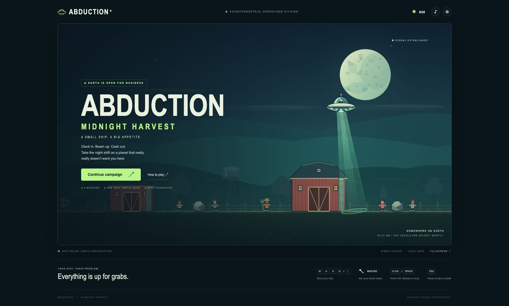

# Abduction: Midnight Harvest

A single-player UFO action game where every object you lift can become **cargo, cover, or a weapon**.

Fly over a midnight landscape, abduct Earth specimens, interrupt armed defenders, shield your ship with carried objects, and turn falling cargo against your enemies. Earn credits, upgrade your UFO, and take on ATLAS—Earth’s very large complaint department.



## What is included

- Five-mission campaign with three difficulty settings.
- Smooth UFO flight, directional tractor beam, extraction, carrying, and dropping.
- Civilians, cows, throwers, gunners, agents, transport trucks, and warned aircraft.
- Solid buildings, temporary shelters, movable cover, and cargo impact damage.
- Encounter director that staggers attacks and creates recovery periods.
- ATLAS boss encounter built around returning cargo to its exposed core.
- Five upgrade categories, optional challenges, mission results, and replay rewards.
- Keyboard, mouse, and on-screen touch controls.
- Pause, restart, sound settings, reduced motion, and versioned local saves.
- Original procedural Canvas artwork and synthesized Web Audio effects.
- Standalone HTML edition, automated tests, profiling tools, and technical audit evidence.

The game runs locally. It has no gameplay server, accounts, multiplayer, advertisements, purchases, or cloud saves.

## Quick start

### Run the development version

Requirements: **Node.js 18 or newer** for npm scripts/tests and **Python 3** for the included local server. There are no npm dependencies to install.

```sh
git clone https://github.com/Abhisheksinha1506/Abduction.git
cd Abduction
npm start
```

Open **http://localhost:4173/** in a modern browser. Stop the server with `Ctrl+C`.

Alternatively, serve `dist/` with any static HTTP server. Open the modular version through HTTP; directly opening `dist/index.html` from disk can prevent JavaScript modules from loading.

### Play the standalone edition

Download the repository and open:

```text
release/Abduction-Midnight-Harvest.html
```

This file embeds the game’s code, styling, artwork, and synthesized audio without external runtime assets. Direct file opening and persistent storage depend on browser policy; the audit verified this same standalone artifact over HTTP, not through `file://`.

For a reliable local browser origin, serve the release folder:

```sh
python3 -m http.server 4173 --bind 127.0.0.1 --directory release
```

Then open **http://localhost:4173/Abduction-Midnight-Harvest.html**.

## Controls

| Action | Input |
|---|---|
| Fly | WASD or arrow keys |
| Aim beam | Mouse position |
| Aim without a mouse | Q / E |
| Lift and collect | Hold left mouse button or Space |
| Drop cargo | Release the beam |
| Pause | Escape or P |
| Touch movement | On-screen thumb pad |
| Touch beam | Hold the BEAM button |

Audio starts after a browser-approved user interaction. Enable sound through the game’s settings if muted.

## How to play

1. Select a mission and fly above a target.
2. Aim downward and hold the beam. Keep specimens aligned until they enter the ship.
3. Lift rocks, trucks, or spent charges to carry them beneath the UFO.
4. Use carried cargo to block shots, or release it above enemies and buildings.
5. Interrupt defenders by lifting them during attack preparation; dodge after their aim locks.
6. Watch aircraft warnings and move away from the flight path, or intercept with cargo.
7. Complete the mission, review earnings, purchase upgrades, and continue the campaign.

The UFO has acceleration and deceleration, so slow down for precise drops. Beam rotation is limited to approximately 40 degrees either side of downward. Taking damage interrupts collection and releases your load.

### Capacity

Starting beam capacity is **30 units**, increasing by 10 per beam-generator upgrade.

| Target or cargo | Load |
|---|---:|
| Civilian, thrower, gunner | 10 |
| Cow or agent | 12 |
| Charge | 16 |
| Rock | 18 |
| Truck | 30 |

People and cows are extracted into the ship. Rocks, trucks, and charges remain physical cargo. A heavy object can block extraction behind it, so carrying protection has a collection cost.

## Campaign and objectives

| Mission | Time limit | Completion condition |
|---|---:|---|
| 1. A quiet little farm | 60 seconds | Survive or clear the population |
| 2. Unwelcome company | 75 seconds | Survive or clear the population |
| 3. The night shift | 90 seconds | Survive or clear the population |
| 4. Restricted airspace | 105 seconds | Survive or clear the population |
| 5. Return to sender | 180 seconds | Defeat ATLAS |

The first four missions are not capture-quota missions. Surviving the timer is a valid victory. Population is finite, including reserves delivered by trucks.

Optional collection, cargo-impact, and aircraft challenges award extra credits without blocking the next mission. First-clear and completed optional-challenge bonuses pay once; regular mission earnings remain available on replay. Failed missions retain half collection earnings.

### ATLAS

Avoid the volley, collect a rock or spent charge, carry it above ATLAS, and drop it onto the core while it glows. Armour deflects cargo outside the exposed window. The boss has three health phases with larger volleys and slightly shorter openings.

| Returned cargo | Core damage |
|---|---:|
| Rock | 26 |
| Charge | 36 |
| Truck | 48 |

### Upgrades

| Upgrade | Effect |
|---|---|
| Abductor crystal | Faster extraction |
| Beam generator | More carrying capacity |
| Hull plating | 10 additional shield points per level |
| Ion drive | Faster flight and tighter handling |
| Cargo processor | 20% more specimen income per level |

## AI and physics

The game uses explicit state machines and seeded randomness, not machine learning or an external AI service.

- **Civilians and cows** wander, notice the UFO, flee, and use reachable shelters.
- **Throwers** prepare gravity-affected attacks against a locked target position.
- **Gunners** hold position while visible and fire faster direct shots.
- **Agents** reposition from recent sightings, predict a short distance ahead, and launch plasma with limited turning and tracking duration.
- **Defenders** can attempt short dodges away from predicted falling-cargo danger.
- **Trucks** enter, stop, unload, and leave while respecting building collisions.
- **Aircraft** follow a warned crossing path rather than chasing the player.
- **The director** limits attack overlap, separates homing preparations, schedules transports, and cycles through introduction, build, peak, and recovery periods.

Physical state takes priority over decisions: lifted enemies stop attacking; released characters fall, land, and recover before acting. Buildings and carried cover affect sightlines, while swept collision tests handle fast projectiles and moving cargo.

Navigation is tailored to horizontal side-view terrain. It does not implement general multi-route pathfinding, stairs, climbing, or a navigation mesh.

## Saves and privacy

Progress and preferences use browser `localStorage`:

- Primary key: `abduction.midnight-harvest.v1`
- Backup key: `abduction.midnight-harvest.v1.backup`

The game saves after mission results, purchases, and preference changes. Save validation checks fields and upgrade ranges, recovers from a last-good backup where possible, and protects unsupported future-version data from being overwritten.

Saves belong to a particular browser profile and origin. Changing browser, hostname, port, or using a standalone file can produce a separate save location. Clearing site data removes local progress. If persistent storage is unavailable, progress may be session-only. There is no cloud synchronization or telemetry.

The modular version references optional web fonts; system fonts provide a fallback. The packaged standalone edition removes that external font import.

## Development commands

| Command | Purpose |
|---|---|
| `npm start` | Serve `dist/` on localhost:4173 |
| `npm test` | Run the automated regression suite |
| `npm run package` | Generate and validate the standalone HTML |
| `npm run archive` | Create the verified source ZIP |
| `npm run profile` | Run seeded CPU and post-GC heap scenarios |

After changing game sources:

```sh
npm test
npm run package
npm run archive
```

Generated files:

```text
release/Abduction-Midnight-Harvest.html
release/Abduction-Midnight-Harvest-source.zip
```

Append `?audit=1` to a served game URL to show local runtime diagnostics. Diagnostics are disabled during ordinary play and transmit no data.

## Project structure

```text
Abduction/
├── dist/                 # Editable browser source and static entry point
│   ├── index.html        # Page structure
│   ├── styles.css        # Responsive UI
│   ├── app.js            # Screens, input, fixed-step loop, results
│   ├── sim.js            # Flight, beam, entities, AI, boss, scoring
│   ├── collision.js      # Sweeps, depenetration, contacts, support queries
│   ├── render.js         # Procedural artwork, animation, effects
│   ├── audio.js          # Synthesized effects and beam hum
│   ├── progression.js    # Save validation, backups, rewards, purchases
│   └── config.js         # Missions, upgrades, world settings
├── tests/                # Node.js regression tests
├── scripts/              # Packaging, archiving, profiling
├── audit/                # Bug tracker, measurements, test evidence, screenshots
├── release/              # Standalone game and source archive
├── AUDIT_REPORT.md       # Technical findings and verification limits
├── CONTRACT.md           # Implementation scope and requirements
└── package.json          # Commands and tooling requirements
```

`dist/` contains the editable source; there is no hidden compilation pipeline. The simulation is separate from the browser UI and advances at a fixed 60 Hz using seconds-based timers. Identical seeds and input sequences support reproducible tests.

## Testing and audit

Release **1.0.1** was audited on **19 October 2026**. The audit recorded **65 passing automated tests** across simulation, collision, AI, campaign progression, saves, rendering, input, audio lifecycle boundaries, and standalone packaging.

See:

- [Detailed audit report](AUDIT_REPORT.md)
- [Structured bug tracker](audit/bugs.json)
- [Recorded test output](audit/test-results.txt)
- [Final simulation profile](audit/profile-final.json)
- [Desktop screenshot](audit/screenshots/desktop.png), [tablet screenshot](audit/screenshots/tablet.png), and [phone screenshot](audit/screenshots/phone.png)

Browser checks included mission play, progression, an upgrade purchase, persistence after reload, pause/settings, restart, and responsive layouts from 320 to 1920 pixels wide. Recorded profiling distinguishes Node.js simulation measurements from browser frame measurements.

### Known verification limits

- Physical touch devices, native fullscreen transitions, and actual high-DPI hardware were not fully verified.
- Audio lifecycle tests do not establish sound quality or behavior on every physical audio device.
- Real graphics-context loss, multi-hour sessions, and a complete cross-browser matrix remain unverified.
- Direct `file://` launch was unavailable in the audit browser; use the local HTTP instructions above for the verified launch path.
- Concurrent tabs writing the same local save are not transactional.

These limits are documented rather than treated as passing tests. No claim is made that every possible defect has been eliminated.

## Implementation and licensing

This is an original JavaScript implementation of the supplied UFO tractor-beam gameplay brief, with procedural artwork and synthesized audio. It is not a literal port of archived ActionScript or a redistribution of the original game’s assets.

No open-source license has been selected for this repository. Public repository access alone does not grant an open-source license; the owner must choose appropriate terms before reuse or distribution by others.
